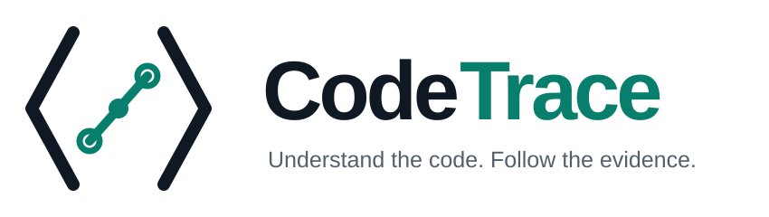

<picture>
  <source media="(prefers-color-scheme: dark)" srcset="img/codetrace-logo.svg">
  
</picture>

# code-trace

CodeTrace permite consultar repositorios de código con respuestas respaldadas por evidencias: archivos, líneas y fragmentos de la instantánea indexada. Puede utilizarse desde una CLI, un chat web local o skills instaladas en otro repositorio.

El proyecto está en desarrollo. El proveedor y el modelo de generación se eligen en la configuración local; pueden ser locales o remotos. La plantilla ilustra una configuración posible y no establece un modelo recomendado o definitivo para el proyecto.

## Qué incluye

- Indexación estructural de código, Gherkin, YAML, JSON y otros formatos configurados.
- Relaciones estáticas entre funciones y repositorios, con soporte específico para pasos Behave.
- Recuperación léxica, estructural y semántica opcional, con presupuestos de contexto explícitos.
- Respuestas con citas y evidencias, inventarios acotados a estructuras compatibles y búsquedas paginadas.
- Diagnóstico de preparación, proveedor y frescura de las fuentes indexadas, con referencia al commit Git.
- Chat local y análisis de flujos estáticos de código.

## Arranque local

Requisitos para los comandos de esta guía: `uv` y `make`. `make setup` usa Python 3.13, la misma versión que CI, y `uv` lo descarga si hace falta. No se necesita Docker. El proveedor de generación elegido debe estar configurado y accesible para producir respuestas.

Desde el checkout:

```bash
make setup
cp config.example.json config.json
```

En una instalación existente, conservar el `config.json` propio. Este archivo está ignorado por Git; la plantilla versionada es [config.example.json](config.example.json).

`make setup` instala CodeTrace en `.venv` como paquete. Vuelve a ejecutar `make setup` cuando actualices el código del repositorio.

Editar en `config.json`:

| Apartado | Qué configura |
| --- | --- |
| `repositories` | Nombres, rutas, aliases y descripciones de los repositorios consultables. |
| `relationships` | Dependencias y relaciones entre repositorios. |
| `indexing` | Lenguajes, exclusiones y generación de chunks. |
| `retrieval` | Recuperación y embeddings opcionales. |
| `context` | Límites de evidencias enviadas al modelo. |
| `skills.installations` | Destinos y repositorios de las skills instaladas. |

Después de ajustar la configuración:

```bash
make indexes
make doctor
make check-provider
make chat
```

`make indexes` genera chunks, relaciones y los vectores semánticos habilitados. La primera preparación puede requerir descargar el modelo de embeddings configurado. `make doctor` diagnostica la preparación y `make check-provider` comprueba el proveedor generativo. Si se elige Anthropic, OpenAI, Azure OpenAI, OpenRouter o Groq, instalar también el extra `llm`, conservando los extras de preparación:

```bash
uv sync --no-editable --extra parsers --extra llm --group dev
```

Configura la generación con variables exportadas o copia [la plantilla](.env.example)
a `.env` en el directorio desde el que ejecutas CodeTrace:

```sh
cp .env.example .env
```

Define `CODETRACE_GENERATION_PROVIDER` y `CODETRACE_GENERATION_MODEL`, además de las
credenciales del proveedor cuando corresponda. Las variables exportadas tienen
prioridad sobre `.env`. La generación queda desactivada si no eliges proveedor.
Si ya tienes un bloque `generation` en `config.json`, traslada sus valores a
`.env` o al entorno y elimina el bloque. CodeTrace ya lo ignora.

| `CODETRACE_GENERATION_PROVIDER` | `CODETRACE_GENERATION_MODEL` | Credenciales y endpoint |
| --- | --- | --- |
| `none` | — | Generación desactivada (valor predeterminado). |
| `mlx` | Ruta al directorio local del modelo MLX LM | Mac con Apple silicon. Sin credenciales ni endpoint. |
| `ollama` | Nombre del modelo local | Endpoint por defecto `http://localhost:11434`. |
| `anthropic` | Nombre del modelo | `ANTHROPIC_API_KEY` o `ANTHROPIC_AUTH_TOKEN`. |
| `openai` | Nombre del modelo | `OPENAI_API_KEY` y, opcionalmente, `CODETRACE_GENERATION_BASE_URL`. |
| `azure_openai` | Nombre del despliegue en Azure | `AZURE_OPENAI_API_KEY` y la URL del recurso en `CODETRACE_GENERATION_BASE_URL` o `AZURE_OPENAI_ENDPOINT`. |
| `openrouter` | ID del modelo con su prefijo, por ejemplo `openai/gpt-4o` | `OPENROUTER_API_KEY`. Endpoint por defecto `https://openrouter.ai/api/v1`. |
| `groq` | ID del modelo en Groq | `GROQ_API_KEY`. Endpoint por defecto `https://api.groq.com/openai/v1`. |

Estos cuatro proveedores requieren un modelo o despliegue que admita Chat Completions en modo JSON. OpenRouter y Groq admiten un endpoint HTTPS alternativo mediante `CODETRACE_GENERATION_BASE_URL`.
Para probar la configuración con una consulta sintética, ejecuta
`codetrace check-provider --allow-remote`. Para enviar evidencias de un repositorio
desde la CLI interactiva, inicia la sesión con `codetrace --repo demo --allow-remote`.

El chat se abre en `http://127.0.0.1:8765`. Seleccionar un repositorio, escribir una pregunta y desplegar las evidencias o el estado del índice. Detener el servidor con `Ctrl+C`.

Más detalles en [preparación de repositorios](docs/es/code-rag-preparacion.md) y [chat local](docs/es/code-rag-chat.md).

### MLX LM en Mac

En Apple silicon, instala el extra con `make setup EXTRAS=mlx`. La sincronización conserva los extras
ya instalados. Configura `mlx` y la ruta al directorio de un
modelo MLX LM ya descargado:

```dotenv
CODETRACE_GENERATION_PROVIDER=mlx
CODETRACE_GENERATION_MODEL=/ruta/al/modelo-mlx
```

El modelo debe responder con el JSON solicitado por CodeTrace. Usa `codetrace check-provider`
para comprobarlo en local. Consulta los detalles en la guía del [chat local](docs/es/code-rag-chat.md#mlx-lm-en-apple-silicon).

## Preguntas desde la terminal

```sh
codetrace --repo demo
```

Escribe una pregunta y pulsa Intro para ver la respuesta. Dentro de la sesión,
usa `codetrace --repo otro_repo` para cambiar de repositorio, `/repos` para
ver los repositorios configurados y `codetrace --exit` o Ctrl+C para salir.
La sesión usa el proveedor configurado en el entorno o en `.env`. Puedes seleccionar
otro catálogo de repositorios con `--config ruta/config.json`.


## CLI

Tras `make setup`, se puede utilizar el comando instalado o el módulo Python:

```bash
.venv/bin/code-trace --help
.venv/bin/python -m codetrace --help
```

Ejemplos con el repositorio `demo` de la plantilla:

```bash
# Respuesta del proveedor configurado, con evidencias.
.venv/bin/code-trace answer "¿Dónde se valida la autenticación?" \
  --config config.json --repo demo --output-format markdown --include-evidence

# Evidencias estructuradas, sin generar una respuesta con el proveedor de CodeTrace.
.venv/bin/code-trace query "autenticación" --config config.json --repo demo --mode evidence

# Diagnóstico de la preparación.
.venv/bin/code-trace doctor --config config.json --repo demo
```

Para autorizar el envío de evidencias al proveedor remoto configurado, añadir `--allow-remote` a la consulta; el chat ofrece la casilla equivalente.

La CLI está disponible como `codetrace`, `code-trace` y `python -m codetrace`.

## Comandos de mantenimiento

| Comando | Uso |
| --- | --- |
| `make indexes` | Preparar todos los repositorios configurados. |
| `make indexes REPOS="demo"` | Preparar una selección y sus dependencias. |
| `make indexes-plan` | Revisar el plan sin generar artefactos. |
| `make indexes-incremental REPOS="demo"` | Actualizar artefactos reutilizando archivos sin cambios. |
| `make doctor` | Diagnosticar preparación y estado de las fuentes. |
| `make check-provider` | Verificar el proveedor de generación. |
| `make chat` | Arrancar la interfaz local. |
| `make evaluate-real` | Evaluar la recuperación con la batería de preguntas reales. |

Se puede seleccionar otra configuración con `CONFIG=/ruta/config.json`. Los artefactos generados en `indexes/` están ignorados por Git y se regeneran a partir de los repositorios configurados.

## Skills

| Skill | Comportamiento |
| --- | --- |
| `code-trace` | Invoca `codetrace answer` y devuelve literalmente la respuesta del modelo configurado en CodeTrace, con sus evidencias. |
| `code-trace-inventory` | Invoca `codetrace query --mode evidence`; el modelo que ejecuta la skill interpreta las evidencias. |

Declarar los destinos en `skills.installations` de `config.json` y ejecutar:

```bash
make skills-install SKILL_ARGS="--dry-run"
make skills-install
make skills-status
make skills-update
```

Las conexiones usan `code_trace_root` y `repo`. Los lanzadores utilizan el Python del entorno de CodeTrace y heredan su catálogo y configuración. No reconstruyen índices automáticamente al consultar. El registro local de instalaciones es `skills/installations.local.json`.

Ver [instalación de skills](docs/es/skills-instalacion.md), [skill code-trace](docs/es/skill-code-rag.md) y [skill code-trace-inventory](docs/es/skill-code-inventory.md).

## Alcance de las respuestas

La recuperación tiene límites de candidatos, chunks, caracteres y tokens. Las evidencias recuperadas no equivalen a un análisis exhaustivo del repositorio ni garantizan un recuento global. Los inventarios completos requieren un alcance explícito compatible: ver [inventarios](docs/es/code-rag-inventory.md).

El análisis de flujo sigue llamadas estáticas entre símbolos Python e identifica candidatos HTTP de FastAPI/Flask. No es una traza de ejecución; middleware, montaje de routers y despacho dinámico pueden quedar sin resolver. Ver [flujos de código](docs/es/code-rag-flujos.md).

El historial del chat solo permanece en la pestaña. Cada pregunta es independiente y no recibe automáticamente la conversación anterior. Las consultas utilizan la instantánea indexada; los avisos de frescura no reconstruyen los índices por sí solos.

Las consultas con generación del chat, `answer`, el modo de respuesta para agentes y
`evaluate-rag` guardan métricas en `indexes/reports/requests.jsonl`, relativo al
directorio de ejecución e ignorado por Git en el checkout de CodeTrace. Cada línea
identifica el origen, el proveedor, el modelo, el estado y los tiempos en segundos.
Las comprobaciones de proveedor se identifican como `check_provider`. El historial
omite preguntas, evidencias, respuestas y mensajes de error. El tiempo total mide
el pipeline dentro de CodeTrace, desde la recuperación hasta la validación cuando
esas etapas forman parte de la consulta.

## Desarrollo y documentación

```bash
make lint
make format-check
.venv/bin/python -m pytest -q
make hooks-install
```

Ruff configura lint y formato en [pyproject.toml](pyproject.toml). El lint JSON y los hooks están definidos en el repositorio. Algunas pruebas levantan servidores HTTP temporales en localhost.

- [Guía del proyecto y compatibilidad](docs/es/code-trace.md).
- [Flujo de CodeTrace](docs/es/flujo-codetrace.md) · [English](docs/en/codetrace-flow.md).
- [Recorrido técnico](docs/es/code-rag-recorrido-tecnico.md) · [English](docs/en/technical-walkthrough.md).
- [Publicaciones](docs/es/releases.md) · [English](docs/en/releases.md).
- [Historial de cambios](CHANGELOG.md).

Con cada versión se actualizan `pyproject.toml`, la documentación afectada y `CHANGELOG.md`, y se registra el cambio mediante un commit descriptivo.
