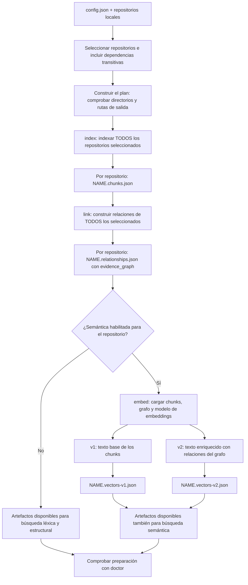
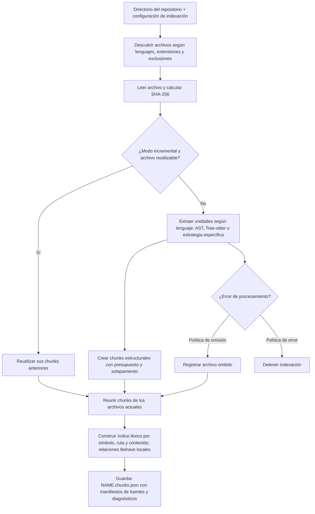
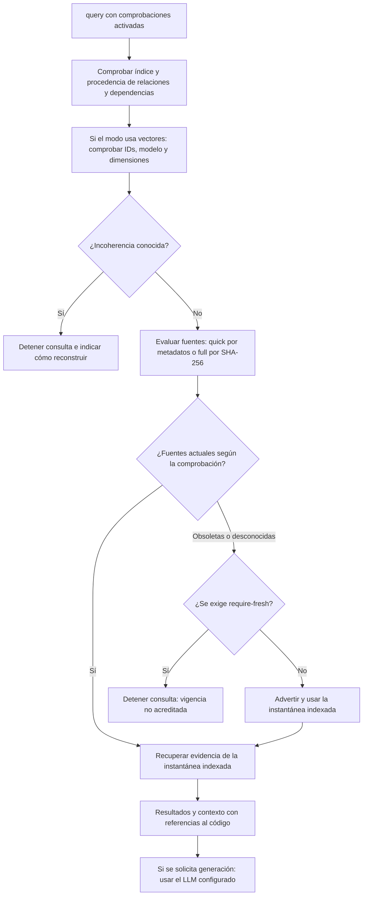

# Cómo preparamos los repositorios para consultar con CodeTrace

Esta guía explica el flujo **implementado** de preparación: cómo pasamos de repositorios locales a una instantánea de código que podemos buscar y utilizar como evidencia. Los diagramas están escritos en Mermaid dentro de Markdown, para mantener juntos el dibujo y su explicación y poder visualizarlos en GitHub o en un visor compatible.

La preparación termina antes de recibir una pregunta. Generar una respuesta con un LLM es un paso posterior y requiere que el proveedor de generación esté disponible.

## Configuración local

Solo se versiona `config.example.json`. Después de clonar el repositorio, crear la configuración local:

```bash
cp config.example.json config.json
```

`config.json` está ignorado por Git y contiene las rutas, proveedores e instalaciones de skills de cada entorno. Ajustarlo antes de preparar los repositorios; no se sobrescribe al actualizar la plantilla. En una instalación existente, el cambio de seguimiento conserva el archivo local. Como Git registra la retirada del antiguo archivo versionado, conviene guardar una copia antes de incorporar esta actualización en otros checkouts con configuraciones personalizadas.

## 1. Del repositorio a los artefactos de consulta

El punto de entrada es `make indexes`, que ejecuta `scripts/build_indexes.py`. Sin selección explícita se preparan todos los repositorios configurados; con `REPOS` se incluyen también sus dependencias transitivas.



Las fases tienen una barrera entre ellas: no se empieza a enlazar hasta terminar todos los índices. Así, por ejemplo, un repositorio de tests puede relacionar sus pasos con una biblioteca compartida que también se acaba de indexar.

`link` analiza relaciones estáticas, dependencias y evidencias, y construye el grafo. Una relación es una candidata derivada del código; no demuestra que esa ruta se haya ejecutado. El flujo estándar no ejecuta los repositorios ni sus tests, ni clona directorios ausentes.

Los artefactos se guardan como JSON local en `indexes/`, junto al archivo de configuración. Los nombres se derivan de la clave del repositorio (`NAME`); las rutas de vectores admiten overrides de configuración. No hace falta una base de datos externa.

Si falla un comando, la preparación se detiene y conserva los resultados anteriores. Que existan archivos no garantiza que todo el conjunto esté actualizado y sea coherente.

## 2. Qué significa indexar un repositorio

Un **chunk** es un fragmento de código con identidad, ruta, rango de líneas, contenido y metadatos. Permite recuperar una parte concreta y citar su ubicación sin enviar todo el repositorio al modelo.



La reutilización incremental comprueba el hash y la compatibilidad pertinente, como el lenguaje y la versión de chunking de configuración. Los archivos eliminados dejan de aportar chunks al nuevo índice. El presupuesto de chunking usa una estimación léxica de tokens, no el tokenizador real del LLM.

El índice conserva también fuentes Python y de configuración para los análisis posteriores. Las exclusiones y los diagnósticos ayudan a entender la cobertura: una preparación puede terminar con archivos omitidos.

`make indexes-incremental` sigue ejecutando `link` y, si corresponde, `embed`. Para los vectores se reutilizan los chunks cuyo texto renderizado no cambia; se recalculan los modificados y se eliminan los ausentes. Un cambio de relaciones puede modificar el texto enriquecido v2 aunque el código del chunk no haya cambiado. Un almacén incompatible con el modelo o sus metadatos se reconstruye. **v1 y v2 distinguen las representaciones base y enriquecida; ambas usan el renderizador de texto actual.**

## 3. Cuándo está listo para consultar

La coherencia de los artefactos, la vigencia respecto al código fuente y la disponibilidad del LLM son comprobaciones distintas. `doctor` permite revisar la preparación por separado. El comando `query` incorpora comprobaciones de preparación antes de recuperar evidencia; esto no debe generalizarse a todos los comandos de búsqueda.



`quick` es la opción predeterminada y puede reutilizar la evaluación durante 30 segundos; `full` lee las fuentes y compara hashes. `--require-fresh` fuerza la comprobación completa y exige fuentes actuales. `--readiness off` desactiva estas comprobaciones. Ninguna de ellas reconstruye automáticamente los artefactos. Los avisos de cobertura por parsers o archivos omitidos siguen siendo relevantes aunque las fuentes estén actuales.

La preparación no inicia Ollama ni comprueba el proveedor generativo. El modelo de embeddings puede necesitar una descarga inicial si no está en caché. `make check-provider` comprueba el proveedor de generación mediante una petición sintética independiente; no verifica la calidad de las respuestas RAG.

## Recorrido práctico

Desde la raíz del proyecto, después de ajustar `config.json` a directorios existentes:

```bash
make setup
make indexes-plan REPOS="demo"       # Validar y mostrar el plan, sin generar artefactos
make indexes REPOS="demo"            # Preparar demo y sus dependencias configuradas
make doctor REPOS="demo"             # Diagnóstico separado de la preparación

# Tras modificar los repositorios:
make indexes-incremental REPOS="demo"

# Comprobación completa de vigencia:
.venv/bin/python -m codetrace doctor --config config.json --repo demo --full
```

Para consultar la instantánea exigiendo fuentes actuales:

```bash
.venv/bin/python -m codetrace query "order_id" \
  --config config.json --default-repo demo --require-fresh
```

## Dónde seguir leyendo el código

| Pregunta | Implementación |
| --- | --- |
| ¿En qué orden se prepara todo? | [`scripts/build_indexes.py`](../scripts/build_indexes.py): `build_plan`, `main` |
| ¿Cómo se descubren archivos y crean chunks? | [`core.py`](../src/coderag/core.py): `discover`, `build_chunks`, `index_repository` |
| ¿Cómo se enlazan repositorios y se crea el grafo? | [`__main__.py`](../src/coderag/__main__.py): comando `link`; [`repo_links.py`](../src/coderag/repo_links.py); [`evidence_graph.py`](../src/coderag/evidence_graph.py) |
| ¿Cómo se preparan los dos almacenes semánticos? | [`prepare_embeddings.py`](../src/coderag/prepare_embeddings.py): `prepare`; [`embedding_index.py`](../src/coderag/embedding_index.py) |
| ¿Cómo se resuelven configuración y rutas? | [`repository_paths.py`](../src/coderag/repository_paths.py); [`semantic_config.py`](../src/coderag/semantic_config.py) |
| ¿Cómo se comprueba la preparación? | [`doctor.py`](../src/coderag/doctor.py); [`preparation.py`](../src/coderag/preparation.py) |

Esta guía describe el recorrido implementado. Al modificar el orden de preparación, los artefactos o las comprobaciones, conviene actualizar también estos diagramas.

## Referencia Git de la última indexación (0.9.17)

Cada `indexes/NOMBRE.chunks.json` incluye ahora `git`: SHA completo del commit, rama (o `null` en HEAD separado), indicador de cambios locales y fecha de captura. `start_commit` y `reference_stable` comparan las referencias al inicio y al final de la indexación. Si cambian durante la lectura, la instantánea se marca como no fijada a una referencia estable. También se registran directorios sin Git, Git no disponible y repositorios que todavía no tienen commits. Los subdirectorios y worktrees enlazados están soportados.

Es el registro de la **última indexación**, no una bitácora de todas las versiones anteriores del índice. Un índice creado con cambios locales contiene esa instantánea de archivos y no representa exclusivamente el commit indicado. Las observaciones no bloquean el árbol de trabajo ni prueban una instantánea atómica frente a cambios concurrentes.

### Consultas y diagnóstico

`coderag query` expone `readiness.git` con las referencias `indexed` y `current`, la relación local (`same_commit`, `ahead`, `behind`, `diverged`, `unborn` o `unknown`) y, cuando están disponibles, los números de commits `ahead`/`behind`. `readiness.needs_update` se decide por las fuentes indexables, no solo por el SHA:

| Estado observado | `needs_update` | Comportamiento |
| --- | --- | --- |
| Cambió el commit, pero las fuentes indexables tienen los mismos hashes | `false` | Aviso de referencia Git distinta; la evidencia sigue representando las fuentes comprobadas |
| Cambiaron fuentes indexables o ajustes de indexación | `true` | Aviso y comando de preparación incremental |
| Falta un manifiesto, la procedencia es antigua o no puede verificarse la fuente | `null` si las fuentes no son verificables | No se afirma frescura; Git puede ser desconocido aunque la fuente sí se pueda comprobar |
| No cambiaron las fuentes comprobadas | `false` | No se requiere reconstrucción por contenido |

Cuando cambia el commit o la rama, el modo rápido comprueba hashes de las fuentes para distinguir los commits de documentación/archivos excluidos de los cambios que afectan al índice. También verifica hashes si detecta metadatos de fuente distintos dentro de un repositorio Git. Las relaciones de historia se calculan con los objetos disponibles localmente: un reset, rebase, historia divergente u objeto antiguo ausente no se interpreta automáticamente como avance. No se ejecuta `fetch` ni se comprueba el estado remoto.

Las sesiones paginadas conservan su instantánea y pueden reutilizar la evaluación rápida de fuentes/Git durante 30 segundos; `checked_at`, `valid_until` y `reused` indican su antigüedad. Después se vuelve a evaluar sin cargar modelos ni releer índices completos. `--require-fresh` sigue exigiendo hashes actuales en cada página, pero un cambio de commit sin cambio de fuentes no provoca un rechazo por frescura. Las sesiones creadas con perfiles anteriores requieren una búsqueda nueva tras actualizar.

`coderag answer`, utilizado por `/code-rag`, añade `index_state` al JSON y a los metadatos del informe. La salida con evidencias incluye un bloque determinista «Estado del índice» con commits, ramas, cambios locales, verificación de fuentes y necesidad de actualización. No altera el texto generado por el proveedor ni cambia el modelo. Este bloque comprueba fuentes/Git; no equivale a la validación completa de relaciones y vectores de `doctor`.

```bash
.venv/bin/python -m codetrace doctor --config config.json --repo fabrica --output-format json
.venv/bin/python -m codetrace query "handoff" --config config.json --repo fabrica
```

`doctor` incorpora un check `git` con ambas referencias y su diagnóstico. Un directorio sin Git sigue siendo utilizable. Un índice antiguo sin estos metadatos puede consultarse, pero su commit indexado será desconocido; la frescura de fuentes se verifica independientemente si tiene manifiesto.

### Actualización explícita

```bash
make indexes-incremental REPOS="fabrica"
```

La preparación existente actualiza chunks, relaciones y vectores habilitados de los repositorios seleccionados y sus dependencias. Los archivos sin cambios reutilizan sus chunks; los vectores sin cambios conservan la lógica incremental existente. Si solo se quiere avanzar la referencia Git registrada tras un commit sin cambios indexables, esa misma preparación registra el nuevo SHA. Las consultas no reconstruyen artefactos automáticamente.

El diagnóstico Git corresponde al árbol de trabajo que contiene el repositorio configurado, incluso si este es un subdirectorio. No guarda rutas de archivos modificados, remotos ni credenciales. El indicador de cambios locales ignora el contenido de submódulos y deshabilita filtros de contenido configurados y fsmonitor para evitar ejecutar procesos del repositorio; por ello puede ser conservador con archivos transformados por filtros. La verificación de fuentes es independiente y decide la necesidad de actualización. Para revisar también todos los repositorios de dependencias, ejecutar `doctor` sin selección de repositorio.

## Avisos Python con ubicación original (0.9.19)

El análisis del archivo Python completo captura los avisos del parser y los guarda en `diagnostics` dentro de `indexes/NOMBRE.chunks.json`. Cada aviso incluye `path` relativo al repositorio, `line` del archivo original, `category`, `message`, `severity: warning`, `language: python` y `type: python_syntax_warning`.

La CLI los muestra una vez en stderr con una ruta completa que permite localizar el origen:

```text
/ruta/al/repositorio/acceptance/common/models/output/use_cases/uc_generic.py:18: SyntaxWarning: "\c" is an invalid escape sequence. ...
```

El aviso conserva la categoría y el mensaje que proporciona la versión de Python utilizada. En versiones anteriores de Python, algunos escapes inválidos se notifican como `DeprecationWarning`; también se registran. Los errores de sintaxis reales mantienen sus políticas de error/omisión existentes. Un aviso no modifica la fuente ni impide generar chunks por sí mismo.

Los análisis derivados de chunks (relaciones Behave, contexto, hooks, rutas de llamadas e inventarios Python) reutilizan un parser que evita reemitir esos mismos avisos con líneas locales o `<unknown>`. No se silencian globalmente otras categorías de advertencias. El worker aislado devuelve los avisos como JSON al proceso principal, que conserva la ruta y la línea antes de imprimirlos.

Los diagnósticos se conservan al reutilizar archivos sin cambios en una indexación incremental y desaparecen si la fuente se corrige o se elimina. Los índices anteriores al campo `python_diagnostics_version` necesitan una pasada de actualización para recoger estos avisos: los archivos Python se vuelven a analizar una vez y después vuelven a poder reutilizarse.

```bash
make indexes-incremental REPOS="sav"
.venv/bin/python -m codetrace analyze --config config.json --repo sav --output /tmp/sav-analysis.json
```

La primera orden actualiza los artefactos con la preparación habitual; la segunda permite consultar los diagnósticos persistidos. No es necesario corregir automáticamente el repositorio indexado para obtener ubicaciones útiles del aviso.

## Consultar desde el navegador (0.9.20)

Una vez preparados los índices y verificado el proveedor de generación, ejecutar `make chat` para abrir el chat local en `http://127.0.0.1:8765`. Reutiliza `config.json` y `coderag answer`, permite seleccionar repositorio y muestra la respuesta, evidencias y estado del índice. No necesita Docker ni una skill.

Ver [la guía del chat](code-rag-chat.md) para opciones de arranque, proveedores remotos y límites de esta primera versión: historial temporal en la pestaña y preguntas independientes, sin memoria conversacional del modelo.
