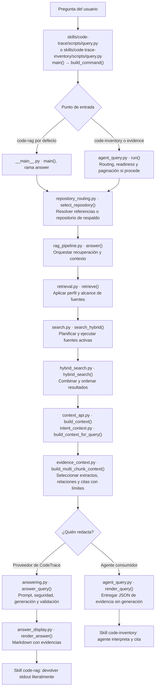
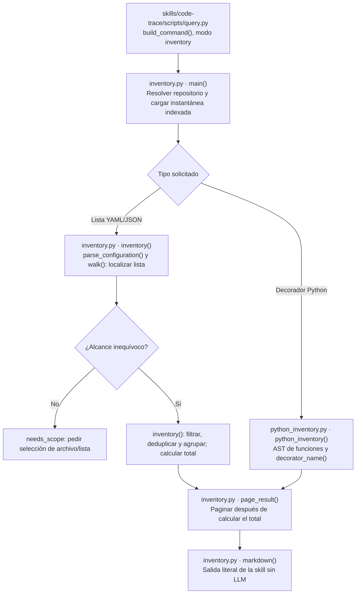

# CodeTrace: recorrido técnico del código a la respuesta

Esta guía sigue el flujo implementado y señala **archivo, función y mecanismo** en cada etapa. Los diagramas muestran el camino principal; las tablas explican los puntos clave sin reproducir todas las llamadas auxiliares. Las rutas `coderag/...` de los diagramas corresponden a `src/coderag/`.

Hay dos momentos: **preparar una instantánea consultable** y **consultarla**. Las skills son puntos de entrada a la consulta; la preparación se ejecuta por separado. No se ejecuta el código de los repositorios indexados.

## 1. Preparación: configuración → chunks → relaciones → vectores

```mermaid
flowchart TD
    A["make indexes o indexes-incremental<br/>Makefile"] --> B["scripts/build_indexes.py · main()<br/>Leer argumentos y ejecutar el plan"]
    B --> C["scripts/build_indexes.py · build_plan()<br/>Seleccionar repositorios y dependencias; comprobar rutas"]
    C --> D["coderag/__main__.py · main(), rama index<br/>Resolver configuración y directorios"]
    D --> E["coderag/core.py · index_repository()<br/>Preparar índice de cada repositorio"]
    E --> F["core.py · discover() / discover_paths()<br/>Filtrar archivos y leer fuentes"]
    F --> G{"¿Archivo reutilizable en modo incremental?"}
    G -->|Sí| H["core.py · index_repository()<br/>Reutilizar chunks anteriores"]
    G -->|No| I["core.py · build_chunks() → units_for()<br/>Extraer unidades estructurales"]
    I --> J["core.py · partition() / split_budget()<br/>Crear fragmentos con presupuesto y solapamiento"]
    H --> K["core.py · index_repository()<br/>Índice léxico, manifiestos y diagnósticos"]
    J --> K
    K --> L["indexes/NAME.chunks.json"]
    L --> M["Tras terminar TODOS los índices:<br/>__main__.py · main(), rama link"]
    M --> N["repo_links.py · build_repository_links()<br/>Resolver relaciones y dependencias"]
    N --> O["evidence_graph.py · build_evidence_graph()<br/>Normalizar nodos y aristas de evidencia"]
    O --> P["repo_links.py · save_links()<br/>Guardar NAME.relationships.json"]
    P --> Q{"¿Semántica habilitada?"}
    Q -->|No| R["Preparación léxica y estructural disponible"]
    Q -->|Sí| S["prepare_embeddings.py · prepare()<br/>Cargar chunks, grafo y modelo"]
    S --> T["embedding_enrichment.py · enrich_chunks_from_graph()<br/>Añadir metadatos relacionados para v2"]
    T --> U["embedding_index.py · update_embedding_store()<br/>Renderizar, comparar hashes y actualizar vectores"]
    U --> V["embedding_provider.py<br/>SentenceTransformerProvider.embed_documents()"]
    V --> W["vector_store.py · VectorStore.save()<br/>NAME.vectors-v1.json y NAME.vectors-v2.json"]
```

`build_plan()` organiza tres fases: **todos los índices**, **todas las relaciones** y **los embeddings habilitados**. El enlace necesita los índices de las dependencias, aunque el orden de selección no sea topológico. Sin `REPOS` se selecciona todo el catálogo; con selección explícita se añaden las dependencias transitivas.

Los errores detienen la ejecución y conservan los artefactos ya generados. El diagrama muestra el recorrido de éxito; políticas como `on_file_error` pueden omitir archivos y dejar diagnósticos de cobertura.

### Descubrimiento, parsing y chunks

| Etapa y función | Qué hace y cómo | Librería o mecanismo |
| --- | --- | --- |
| [`core.py`](../src/coderag/core.py) · `discover_paths()`, `discover()` | Detecta lenguajes por nombre/extensión y overrides, aplica exclusiones y obtiene fuentes aptas para indexar. | Código propio; biblioteca estándar para rutas, lectura y patrones. |
| `core.py` · `python_units()` | Lee funciones, funciones async y clases, con nombres y rangos; incluye decoradores en el comienzo de la unidad. | `ast.parse()` de Python. Analiza sintaxis sin importar el módulo. |
| `core.py` · `treesitter_units()` | Recorre el árbol de sintaxis de los lenguajes configurados en `TREE_LANG` y recoge nodos estructurales. Puede registrar recuperación de errores sintácticos. | `tree-sitter-language-pack`, mediante `get_parser()` y `parser.parse()`. Dependencia opcional `parsers`. |
| [`configuration_chunks.py`](../src/coderag/configuration_chunks.py) · `configuration_units()`, `parse_configuration()` | Identifica unidades y rutas estructurales YAML/JSON conservando posiciones en el texto. | YAML: eventos de **PyYAML** con `SafeLoader`. JSON: parser estructural propio `JsonStructure`, apoyado en `json` para valores. |
| `core.py` · `gherkin_units()`, `make_units()` | Extrae unidades específicas, por ejemplo escenarios Gherkin o bloques Makefile. | Código propio; no se usa un parser externo para estas funciones. |
| `core.py` · `attach_leading_docs()`, `partition()` | Asocia documentación precedente y organiza bloques estructurales y código circundante. | Código propio sobre líneas y rangos. |
| `core.py` · `split_budget()` | Mantiene bloques que caben; divide los grandes y reutiliza parte del final como solapamiento. Una línea demasiado larga se divide por límites de tokens léxicos. | Código propio y `re`; el solapamiento está acotado por el presupuesto y los fragmentos disponibles. |
| `core.py` · `build_chunks()` | Construye cada chunk con contenido, símbolo, lenguaje, líneas, estrategia, hashes y estimación de tokens. | `hashlib.sha256()`; ID de 16 caracteres derivado de ruta, líneas y contenido. |
| `core.py` · `index_repository()` | Reúne chunks, crea un índice de términos por símbolo/ruta/contenido, guarda fuentes completas Python y YAML/JSON, manifiestos y diagnósticos. | Diccionarios y JSON; escritura del índice mediante archivo temporal y sustitución atómica. |

Un **chunk** es la unidad recuperable y citable. Por ejemplo, una función pequeña puede formar un fragmento; una función extensa puede dividirse en varios. Sus líneas remiten al archivo original. El rango y el símbolo permiten ubicar la evidencia, mientras el contenido es lo que se recupera o transforma en embeddings.

En modo incremental, `index_repository()` compara SHA-256 por archivo y condiciones de reutilización, como lenguaje y compatibilidad del chunking de configuración. Los archivos ausentes dejan de aportar chunks al nuevo índice. Las relaciones se regeneran después; no se mantienen automáticamente por reutilizar chunks.

### Tokens: tres mecanismos que conviene distinguir

| Uso | Implementación | Qué significa el límite |
| --- | --- | --- |
| Tamaño de los chunks | `core.py` · `token_count()` usa `re.compile(r'\w+|[^\w\s]')`; `split_budget()` aplica el presupuesto. | Cuenta grupos de caracteres de palabra y signos individuales, ignorando espacios. Por ejemplo, `x = foo(a)` cuenta 6 unidades. Es una medida léxica propia. |
| Tamaño del contexto recuperado | [`evidence_context.py`](../src/coderag/evidence_context.py) · `build_multi_chunk_context()` estima tokens por extracto con `(len(content) + 3) // 4`. | Aproxima un token por cuatro caracteres y aplica también límites de chunks y caracteres. No mide exactamente el prompt completo ni garantiza que quepa en cualquier modelo. |
| Entrada del modelo de embeddings | [`embedding_provider.py`](../src/coderag/embedding_provider.py) · `SentenceTransformerProvider.embed_documents()` llama a `SentenceTransformer.encode()`. | La tokenización y el límite efectivo de secuencia pertenecen al modelo cargado y a `sentence-transformers`. El presupuesto léxico de chunks no garantiza que todo su texto renderizado quepa en ese límite. |

Por tanto, `max_tokens` de chunking, presupuesto estimado del contexto y límites de entrada/salida del modelo son controles distintos. El proyecto no aplica un único tokenizador de LLM de principio a fin.

### Relaciones, grafo y embeddings

| Etapa y función | Qué hace y cómo | Librería o mecanismo |
| --- | --- | --- |
| [`repo_links.py`](../src/coderag/repo_links.py) · `build_repository_links()` | Carga el índice elegido y sus dependencias transitivas, recoge evidencia de enlaces y deja procedencia de los índices utilizados. | Análisis estático propio y JSON local. |
| [`evidence_graph.py`](../src/coderag/evidence_graph.py) · `build_evidence_graph()` | Construye nodos y aristas con identidades deterministas a partir de índices y relaciones, incluyendo evidencias de llamadas y datos. | Código propio con diccionarios, listas y hashes; grafo persistido dentro del JSON de relaciones. |
| [`prepare_embeddings.py`](../src/coderag/prepare_embeddings.py) · `prepare()` | Resuelve rutas/modelo, carga el grafo y prepara dos representaciones: base v1 y enriquecida v2. | Configuración propia; `VectorStore` y proveedor de embeddings. |
| [`embedding_enrichment.py`](../src/coderag/embedding_enrichment.py) · `enrich_chunks_from_graph()` | Añade claves relacionadas, tipos de acceso y etiquetas de relaciones a los metadatos de chunks. | Recorrido propio del grafo. |
| [`embedding_text.py`](../src/coderag/embedding_text.py) · `chunk_embedding_text()` | Convierte contenido y metadatos en el texto que representará el vector. | Renderizador determinista propio. v1/v2 distinguen base y enriquecimiento; ambas usan el renderizador actual. |
| [`embedding_index.py`](../src/coderag/embedding_index.py) · `update_embedding_store()` | Compara hash del texto renderizado y versión, reutiliza vectores, genera los pendientes y elimina IDs ausentes. | `hashlib` y código propio. `prepare()` descarta registros si los metadatos del almacén son incompatibles. |
| `SentenceTransformerProvider` · `embed_documents()` | Codifica lotes de textos y devuelve listas de números de dimensión fija; valida los vectores. | **sentence-transformers**, dependencia opcional `embeddings`. Modelo seleccionado por configuración. |
| [`vector_store.py`](../src/coderag/vector_store.py) · `VectorStore.save()`, `search()` | Guarda vectores y metadatos en JSON; compara una consulta con los registros mediante similitud coseno y ordena los resultados. | Código propio con `json` y `math`; búsqueda por recorrido de registros, sin índice aproximado externo. |

Los embeddings acercan textos según la representación del modelo; la similitud no prueba equivalencia ni ejecución. La representación enriquecida puede cambiar si cambian las relaciones aunque no se modifique el código del chunk.

## 2. Consulta: entrada → recuperación → contexto → entrega

El diagrama reúne las rutas normales de consulta, no un único árbol de llamadas literal: `agent_query.run()` usa `render_query()` para construir la salida y desde este recorrido llama al pipeline. La ruta `answer` tiene su propio manejo de CLI; no hereda automáticamente todas las comprobaciones o flags de `query`. `--resolve-only` termina tras resolver el repositorio, antes de cargar índices/modelos.

### Recuperación y construcción del contexto

| Etapa y función | Qué hace y cómo | Librería o mecanismo |
| --- | --- | --- |
| Launchers de las skills · `build_command()` | Lee `config.local.json`, valida checkout/entorno y construye el comando con el Python de CodeTrace y el `config.json` central. | `pathlib`, `json`, `subprocess`; ejecución sin shell. |
| [`repository_routing.py`](../src/coderag/repository_routing.py) · `select_repository()` | Resuelve nombres, aliases y referencias acotadas por descripción; usa el respaldo cuando corresponde. La ambigüedad se comunica. | Código determinista con `re` y `unicodedata`; sin clasificación por LLM. |
| [`preparation.py`](../src/coderag/preparation.py) · `inspect_preparation()`, `evaluate_readiness()` | En `query`, comprueba coherencia y evalúa vigencia: metadatos en quick o hashes en full. `--require-fresh` exige fuentes actuales. | Código propio, metadatos de archivos y SHA-256. No reconstruye índices. |
| [`query_planning.py`](../src/coderag/query_planning.py) · `plan_query()` | Extrae términos y variantes deterministas, identifica anclas y conserva el texto para las fuentes pertinentes. | `re`, `unicodedata` y reglas propias. |
| [`lexical_search.py`](../src/coderag/lexical_search.py) · `search_index()` | Busca términos en símbolos, rutas o contenido utilizando el índice preparado. | Recuperación propia; no debe describirse como BM25 por el diagrama antiguo de arquitectura objetivo. |
| [`structural_search.py`](../src/coderag/structural_search.py) · `search_graph()` | Recupera evidencias según nodos, relaciones y claves del grafo, incluyendo perfiles de acceso. | Recorrido y puntuación propios sobre el grafo JSON. |
| [`semantic_search.py`](../src/coderag/semantic_search.py) · `search_vectors()` | Representa la pregunta con el proveedor de embeddings y busca vectores cercanos. | `sentence-transformers` para codificación; `VectorStore.search()` para coseno. |
| [`search.py`](../src/coderag/search.py) · `search_hybrid()` | Coordina fuentes activas y el perfil semántico; combina resultados v1/v2 cuando corresponde. | Código propio; [`two_stage_retrieval.py`](../src/coderag/two_stage_retrieval.py) · `two_stage_retrieve()` para el perfil de dos etapas. |
| [`hybrid_search.py`](../src/coderag/hybrid_search.py) · `hybrid_search()` | Fusiona fuentes y ordena candidatos según las reglas y señales de ranking aplicables. | Fusión/ranking propios; no llama a un servicio externo de reranking en esta función. |
| [`context_api.py`](../src/coderag/context_api.py) · `build_context()` | Expone la API de contexto, delega selección por intención y añade evaluación si hay etiquetas relevantes. | Código propio; `intent_context.build_context_for_query()`. |
| [`evidence_context.py`](../src/coderag/evidence_context.py) · `build_multi_chunk_context()` | Deduplica, incorpora evidencia relacionada cuando se permite y selecciona extractos bajo presupuestos; devuelve citas y exclusiones. | Código propio sobre chunks y grafo. La paginación desactiva expansión para separar páginas. |

**Recuperación** selecciona candidatos; **contexto** decide cuáles de sus evidencias caben. Por eso un match puede aparecer como metadato sin extracto incluido. El ranking explica un orden, no una probabilidad de verdad. Ni el límite de recuperación ni el presupuesto de contexto acreditan exhaustividad.

### Generación y presentación

| Etapa y función | Qué hace y cómo | Librería o mecanismo |
| --- | --- | --- |
| [`generation_factory.py`](../src/coderag/generation_factory.py) · `build_generation_provider()` | Construye el adaptador según configuración de generación. | Adaptadores propios para Ollama o Anthropic; credenciales desde entorno cuando corresponde. |
| [`grounded_prompt.py`](../src/coderag/grounded_prompt.py) · `build_grounded_prompt()` | Construye instrucciones y evidencia para pedir respuesta estructurada, citas y reconocimiento de evidencia insuficiente. | Plantilla propia. El código recuperado se trata como datos no confiables. |
| [`answering.py`](../src/coderag/answering.py) · `answer_query()` | Valida seguridad, construye el prompt, llama a `provider.generate()` y valida el resultado. | Orquestación propia. |
| [`ollama_provider.py`](../src/coderag/ollama_provider.py) · `OllamaProvider.generate()` | Envía la petición al endpoint Ollama configurado e interpreta la respuesta. | HTTP con `urllib.request` y JSON; el modelo se ejecuta en Ollama. |
| [`anthropic_provider.py`](../src/coderag/anthropic_provider.py) · `AnthropicProvider.generate()` | Llama al proveedor Anthropic y transforma su salida al contrato de generación. | SDK **anthropic**, dependencia opcional `llm`. |
| [`generation.py`](../src/coderag/generation.py) · `validate_generation_result()` | Comprueba claims, citas, rutas, rangos y certeza frente al contexto disponible. | Validación propia; no sustituye una evaluación semántica de calidad. |
| [`answer_display.py`](../src/coderag/answer_display.py) · `render_answer()` | Presenta respuesta y evidencia en Markdown, con referencias y metadatos. | Formateo propio. La skill `code-trace` entrega la salida literalmente. |
| [`agent_query.py`](../src/coderag/agent_query.py) · `render_query()` | En modo evidence devuelve el sobre JSON con resultados, citas, contexto y límites. | Sin llamada al proveedor generativo de CodeTrace; el agente de `code-trace-inventory` redacta después. |

## 3. Rama exhaustiva: inventario acotado

El modo `inventory` de `code-trace` sigue un camino distinto a la recuperación limitada. La skill llamada `code-trace-inventory` usa búsquedas de evidencia y no activa este inventario automáticamente.

Las listas se identifican por archivo y ruta estructural; `--where` filtra valores escalares exactos antes de `--unique-by`, y `--group-by` agrupa si se solicita. Para Python se usa `ast` sobre la fuente guardada en el índice y se cuentan funciones con un decorador explícito en un archivo. No se importan módulos ni se resuelven registros dinámicos. Véanse [`inventory.py`](../src/coderag/inventory.py) y [`python_inventory.py`](../src/coderag/python_inventory.py).

## Artefactos y dependencias de un vistazo

| Resultado | Contenido y consumidor |
| --- | --- |
| `indexes/NAME.chunks.json` | Fragmentos citables, índice léxico, fuentes guardadas, manifiestos y diagnósticos. Lo consumen enlace, recuperación e inventario. |
| `indexes/NAME.relationships.json` | Relaciones, procedencia y `evidence_graph`. Lo consumen búsqueda estructural, expansión y enriquecimiento semántico. |
| `indexes/NAME.vectors-v1.json` | Vectores del texto base y metadatos. Lo consume la búsqueda semántica. |
| `indexes/NAME.vectors-v2.json` | Vectores de la representación enriquecida. Lo consume la búsqueda semántica según perfil. |
| Sesiones e informes opcionales | Persisten páginas o resultados; pueden contener extractos de fuentes. No reemplazan los índices. |

Los nombres anteriores son las rutas estándar junto a la configuración central; los vectores admiten overrides. Las dependencias declaradas están en [`pyproject.toml`](../pyproject.toml): **PyYAML** es base; **tree-sitter-language-pack**, **sentence-transformers** y **anthropic** son opcionales. Chunking, índice léxico, grafo, fusión, almacén vectorial y gestión de contexto se implementan en el propio proyecto.

Para ejemplos operativos y detalles de cada entrada: [preparación](code-rag-preparacion.md), [skill code-rag](skill-code-rag.md) y [skill code-inventory](skill-code-inventory.md). Esta guía debe actualizarse cuando cambien funciones, artefactos o mecanismos del recorrido.

## Flujos estáticos en respuestas (0.9.21)

En consultas con proveedor de generación, `rag_pipeline.answer` habilita el análisis de flujo de `intent_context`. `code_flow.py` reconoce intención, identifica candidatos HTTP de FastAPI/Flask o símbolos de inicio explícitos, y recorre aristas `calls` con evidencia `static_unique_call_target`. Ante esa intención, los candidatos estructurales se sitúan antes de las coincidencias genéricas. `build_multi_chunk_context` sigue aplicando los presupuestos habituales; después se eliminan de `context.code_flow` las aristas sin ambos extremos seleccionados. El prompt incorpora el alcance, la ambigüedad y las limitaciones del flujo. Chat y salida con evidencias muestran las relaciones sin modificar el texto del modelo.

El modo de evidencias sin generación conserva su selección y paginación. No cambia el esquema de los artefactos ni se ejecutan imports de los repositorios. Ver [la guía de flujos](code-rag-flujos.md).
