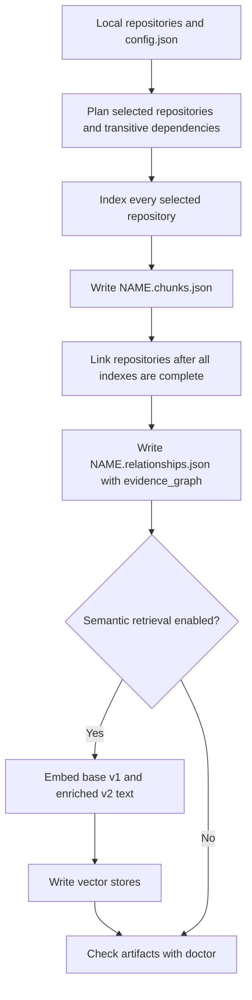
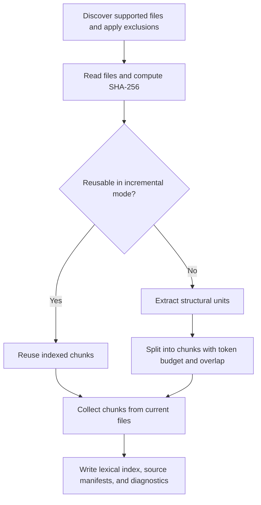

# Preparing repositories for CodeTrace

[Español](../es/code-rag-preparacion.md)

Preparation turns local repositories into searchable snapshots before any question is asked. Copy `config.example.json` to the gitignored `config.json` and configure repository paths, indexing, and retrieval. Set the generation provider separately in `.env` or the process environment. Keep your local settings when updating the example.

## Toolium dependencies

Declare `"framework": "toolium"` on repositories that provide Toolium or Toolium Telefónica, and list direct dependencies under `relationships`. In this example, the test repository lists the extension as its only direct dependency.

```json
{
  "repositories": {
    "framework-base": {"path": "../toolium", "framework": "toolium"},
    "framework-extension": {"path": "../toolium-telefonica", "framework": "toolium"},
    "acceptance": {"path": "../acceptance"}
  },
  "relationships": {
    "framework-extension": {"dependencies": ["framework-base"]},
    "acceptance": {"dependencies": ["framework-extension"]}
  }
}
```

In `auto` mode, CodeTrace enables analysis when the repository or a transitive dependency declares the framework, or when the repository’s indexed Python imports `toolium` or `toolium_telefonica`. Repository identifiers are arbitrary. Use `analysis.toolium` to set `enabled` or `disabled` globally or per repository. After changing the declarations, regenerate relationships with `make indexes-incremental REPOS="acceptance"`.

## Build artifacts



`make indexes` runs [scripts/build_indexes.py](../../scripts/build_indexes.py). Without `REPOS`, it processes all configured repositories. A selection includes its transitive dependencies. Linking waits for all selected indexes so that cross-repository dependencies can use the new snapshots. Links and graph edges describe static evidence. Preparation uses local checkouts and writes JSON artifacts under `indexes/` beside the configuration. Vector paths can be overridden. A failed command stops the remaining phases and preserves artifacts already written.

## Index source files



Each chunk has an ID, path, original line range, content, and metadata. Depending on the language, CodeTrace uses Python AST, Tree-sitter, or a specialized parser. The chunk budget measures lexical tokens. Source snapshots support later Python and configuration analysis. Error policies can skip files and record diagnostics or stop indexing. Exclusions and skipped files affect coverage.

Incremental indexing checks source hashes and relevant compatibility metadata. Removed files disappear from the index. `make indexes-incremental` still links artifacts and embeds when enabled. Embedding updates reuse vectors for unchanged rendered text and remove absent chunks. v1 embeds the base representation and v2 enriches it with relationships. Relationship changes can therefore invalidate v2 even when source is unchanged. Both stores use the current renderer. Incompatible model or metadata requires rebuilding the store.

## Readiness and Git provenance

`doctor` checks preparation separately from provider availability. `query` can check index and relationship provenance, dependency compatibility, and vector IDs, model and dimensions when needed. Known mismatches stop the query. The default quick check uses metadata and can reuse a result for 30 seconds. Full mode verifies source hashes. `--require-fresh` requires a full check and current sources, and `--readiness off` bypasses these checks. Otherwise stale or unverifiable sources can be reported while the query uses the indexed snapshot.

Chunk indexes record the Git commit, branch, local changes, and capture time. `start_commit` and `reference_stable` describe whether the reference changed during indexing. The record covers the latest index and can include local changes. Linked worktrees, subdirectories, and repositories without a commit are supported. Git inspection does not contact remotes.

`query` reports indexed and current references in `readiness.git` and source freshness in `readiness.needs_update`. The latter is true for changed indexable sources or indexing settings, false for verified unchanged sources, and null when freshness cannot be determined. A change in Git reference can trigger content hashing even in quick mode. Continuation pages retain the same snapshot and can reuse a quick check until it expires. With `--require-fresh`, hashes are checked on each page. `answer` reports source and Git state in `index_state`, while `doctor` also checks artifact consistency. Updating artifacts is explicit.

## Commands

```bash
make setup
make indexes-plan REPOS="demo"
make indexes REPOS="demo"
make doctor REPOS="demo"
make indexes-incremental REPOS="demo"
.venv/bin/python -m codetrace doctor --config config.json --repo demo --full
.venv/bin/python -m codetrace query "order_id" \
  --config config.json --default-repo demo --require-fresh
```

Generation has a separate synthetic check, `make check-provider`. For remote providers add `PROVIDER_ARGS=--allow-remote`. Semantic preparation can download the embedding model on first use. Once preparation is complete, run `make chat` to open the [local browser interface](local-chat.md).

## Python parser diagnostics

The first parse of a full Python file records warnings under `diagnostics` with the original relative path, line, category, message, severity, language, and type `python_syntax_warning`. The CLI prints them once to stderr with absolute paths. Isolated parser workers return diagnostics to the main process. Derived analyses avoid re-emitting the same warnings at chunk-local line numbers. Syntax errors retain the configured fail-or-skip policy. Incremental runs keep diagnostics for reused files and remove them when a file is corrected or removed. Older indexes without `python_diagnostics_version` reparse Python files on their next update.

```bash
make indexes-incremental REPOS="sav"
.venv/bin/python -m codetrace analyze --config config.json --repo sav \
  --output /tmp/sav-analysis.json
```

Follow [index construction](../../src/codetrace/core.py), [repository links](../../src/codetrace/repo_links.py), [embedding preparation](../../src/codetrace/prepare_embeddings.py), and [readiness checks](../../src/codetrace/preparation.py) in the code.
