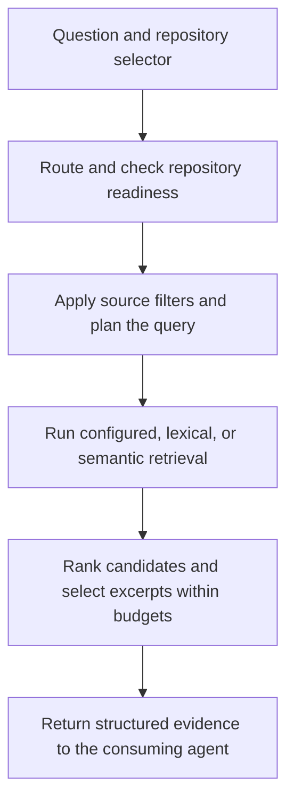

# The code-trace-inventory skill

[Español](../es/skill-code-inventory.md)

The launcher runs `codetrace query --mode evidence`. It returns JSON so the consuming agent can review excerpts and answer with citations. The agent receives those excerpts, so its own processing location matters even when CodeTrace uses no generation provider.

## From question to evidence



The installed connection identifies the checkout and fallback repository. Explicit `--repo NAME`, including a trailing unquoted selector in the question, can select another repository. Unknown and conflicting selectors fail explicitly. Recognized repository scope clauses are stripped before retrieval. `--resolve-only` reports routing without loading models or indexes. `--require-fresh` checks source hashes. Known artifact mismatches stop the query, while ordinary readiness checks can report stale sources and use the existing snapshot.

Use `--file` for an exact repository-relative path, `--directory` for a directory and descendants, and `--source-type` for an indexed language such as `python`, `yaml`, or `gherkin`. Filters of the same type combine with OR and different types combine with AND. They scope sources before retrieval limits. Lexical planning uses deterministic variants, and semantic-only mode uses embeddings without running lexical variants. Ranking signals describe matches to the indexed text.

## Budgets

The launcher selects `--budget-profile code-inventory`. Configure it in the checkout's central configuration:

```json
{
  "query_profiles": {
    "code-trace-inventory": {
      "limit": 30,
      "max_chunks": 10,
      "max_chars": 40000,
      "max_tokens": 10000
    }
  }
}
```

All four fields accept positive integers. Missing profile settings fall back to the ordinary configuration. Limits apply simultaneously to a maximum candidate pool and a smaller evidence context. Evidence tokens are estimates for excerpts rather than the complete answer. Explicit `--limit`, `--max-chunks`, and `--max-chars` can request smaller limits. The result records `retrieval.budget_profile` and effective limits. The profile applies to evidence mode only.

## Pagination and follow-up

```bash
.venv/bin/python skills/code-trace-inventory/scripts/query.py "In demo, where is order_id used?" \
  --retrieval-mode lexical --source-type python --page-size 5
```

To continue, repeat the request and pass the exact `pagination.next_cursor` as `--cursor`. Keep the question, repository, filters, retrieval mode, limit, and custom `--session-dir` consistent. Sessions retain the ranked pool and excerpts for an hour by default, without extending expiry on continuation. Expired, absent, or invalid sessions require a fresh search. `--no-session` uses a new search with artifact hash checks. `--report PATH` saves the structured result. Structural expansion is disabled for pagination to keep pages disjoint.

Use `chunk_id` to join matches, excerpts, and citations. A match may lack an excerpt under the context limits. `total_matches: null` means the total is unknown. Reaching the last page exhausts the retrieved pool. For exact counts within an explicit scope, use the [inventory command](cli-inventory.md).

## Git status and implementation

`readiness.git` describes the indexed and current references. `readiness.needs_update` reflects source freshness independently of commit identity. Sessions can reuse quick checks for 30 seconds. Update with `make indexes-incremental` when required and refresh installed skills with `make skills-update`.

See the [skill contract](../../skills/code-trace-inventory/SKILL.md), [launcher](../../skills/code-trace-inventory/scripts/query.py), [query implementation](../../src/codetrace/agent_query.py), and [session handling](../../src/codetrace/query_sessions.py).
