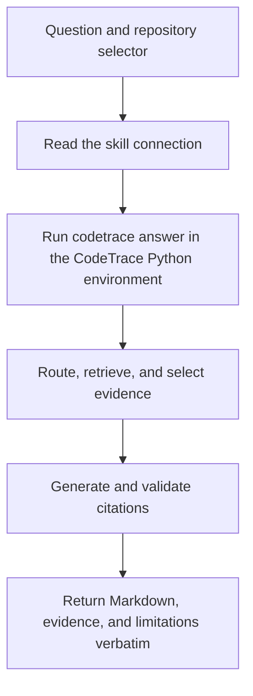

# The code-trace skill

[Español](../es/skill-code-rag.md)

The skill runs `codetrace answer` with Markdown and evidence enabled and returns stdout verbatim. CodeTrace's configured provider writes the answer. A counting question still follows this path. The launcher accepts `--mode answer` for compatibility. Structural counts are available through the [standalone inventory command](cli-inventory.md).



## Configure and invoke

The installed `config.local.json` declares `code_trace_root` and `repo`. Relative checkout paths resolve from that file. The fallback repository must exist in CodeTrace's central catalog. A repository selector or an explicit repository reference in the question can select another configured repository.

```json
{
  "code_trace_root": "/absolute/path/to/code-trace",
  "repo": "demo"
}
```

From the CodeTrace checkout:

```bash
.venv/bin/python skills/code-trace/scripts/query.py \
  "How does user authentication work?" --repo demo
```

On Windows use `.venv/Scripts/python.exe`. The launcher's `--config PATH` selects a different connection file. Retrieval and context budgets come from the checkout's central configuration. Generation settings come from exported variables or the checkout's `.env`. Explicit `--limit`, `--max-chunks`, and `--max-chars` are forwarded. Use `--allow-remote` when explicitly authorizing a remote provider. Provider setup or request errors end the request.

## Repository selection and evidence

A trailing unquoted `--repo NAME` or `--repo=NAME` can select a configured repository. Scope clauses such as `in REPOSITORY` are removed from the normalized question where recognized. Quoted identifiers and terms that are the subject of the question are preserved. Conflicting selectors return `conflicting_repository`; unknown repositories return `unknown_repository`. The original question remains in reports and the normalized version is in `routing.query`.

The `identifier-v2` ranking favors identifiers and access signals, then uses term coverage to order natural-language candidates within those priorities. Semantic-only mode has its own ordering. The prompt asks the provider to answer in the question's language or an explicitly requested language and to state the evidence limits. The validation checks citations against available chunks and line ranges. Semantic support and exhaustive counts require separate evaluation. Run `make evaluate-real CONFIG=config.example.json` after preparing the bundled demo repositories to check retrieval.

## Diagnose and update

`--resolve-only` returns routing without loading indexes or models. `--report PATH` saves an answer and its evidence context. `index_state` reports indexed and current Git state, source freshness, and a rebuild command where applicable. A change in commit alone does not require new artifacts. See [repository preparation](repository-preparation.md).

Update installed copies with `make skills-update`. The [skill instructions](../../skills/code-trace/SKILL.md) and [launcher](../../skills/code-trace/scripts/query.py) define the executable contract.
