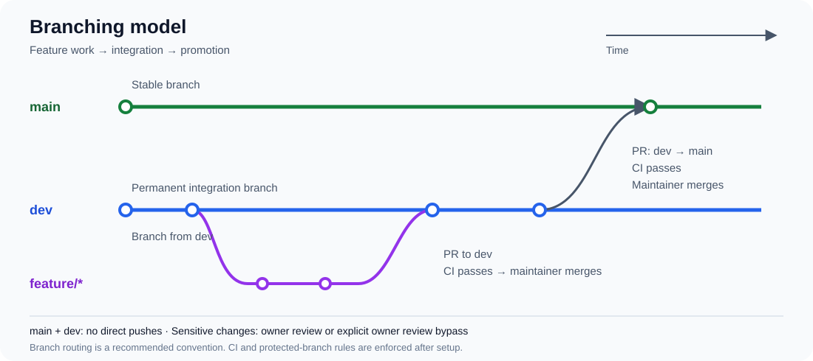

# Repository setup guide

A reusable starting point for GitHub repositories with protected `main` and `dev`
branches, required pull requests, CI gates, and one designated user who can merge
to `main` and `dev`.

**Creating a repository from this template does not activate its rulesets.** GitHub
copies repository files, not branch protection settings. The configuration script
must be run separately by a repository administrator.

## Policies

| Action | `main` | `dev` |
| --- | --- | --- |
| Direct push, including by the designated merger | Blocked |
| Changes through a pull request | Required | Required |
| Required CI checks pass and branch is up to date | Required | Required |
| Resolve review conversations before merging | Required | Required |
| Sensitive files changed by other contributors | Code-owner approval required | Code-owner approval required |
| Who can merge | The explicitly selected user | The explicitly selected user |
| Force push or delete branch | Blocked | Blocked |

Three rulesets keep permissions, reviews, and quality requirements separate:

- `template-protected-branches` applies PR requirements, CI checks, force-push and
  deletion protections to both branches. It has **no bypass actors** in the default configuration.
- `template-main-merge-owner` restricts updates to `main` and `dev`.
  The ruleset keeps its original name so reapplying updates it in place. Only the selected user
  receives a bypass, limited to pull requests. It does not bypass the first ruleset.
- `template-sensitive-file-reviews` requires code-owner approval on both branches
  when a PR changes owned files. Only the selected user can bypass this review
  requirement, and only through a PR. The selected user has no CI bypass.

The general approval count stays at zero: ordinary application changes do not
require a review under this template. Sensitive changes by other contributors
require the designated code owner's approval. New reviewable commits invalidate
previous approvals. Opening a PR and passing CI remain mandatory for everyone.

GitHub does not allow authors to approve their own PRs. If you are the designated
owner and author a sensitive change, wait for CI and explicitly use the PR-only
bypass of `template-sensitive-file-reviews` when merging. This is an audited review
exception, not a self-approval; it also applies when the selected owner merges
someone else's PR without an approval. It never bypasses the separate CI or direct
push protections. Do not add an owner bypass to `template-protected-branches`.

Administrators can edit the rulesets themselves; these policies control normal
branch operations, not the ability to administer the repository.

The rulesets do not restrict PR source branches: `feature/* → dev → main` is the
recommended process, not an enforced source-branch constraint. They also do not
restrict who creates release tags; add a separate tag ruleset if needed.

## Prepare this repository as a template

1. Review these files, commit, and push them to the template repository's `main`.
2. Enable **Settings → General → Template repository** on GitHub.
3. Use **Use this template → Create a new repository** for future projects.
4. Copy only the default branch. Create `dev` from the new repository's `main` so
   both branches share Git history; do not copy all template branches.

Use `make init` to configure the new repository after cloning it.

## Default license

The template includes the [Apache License, Version 2.0](../LICENSE). New repositories
inherit this file. Review the [README license guidance](../README.md#license) when
starting a project, including copyright notices and package metadata. If choosing
another license, document the change and retain applicable notices for reused code.

## Configure a new repository

For the normal setup, follow the [quick guide](../STEP_GUIDE.md) and run
`make init`. It creates `dev`, waits for CI and applies the rulesets.
The steps below describe the underlying configurator for inspecting or
applying the rulesets individually.


### 1. Prepare branches and CI

Clone the newly created repository and set its code owner before enabling rules.
The included `.github/CODEOWNERS` currently names `@manon42bcn`. To select yourself
or another maintainer, run:

```sh
python3 scripts/configure_repository.py --merger YOUR_USER --prepare-codeowners
```

This explicit preparation mode writes **only the local managed CODEOWNERS file**,
without authentication, GitHub calls, commits or branch changes. It replaces that
file, so review its diff before committing. The file protects all of `/.github/`
(including itself and workflows), `/policies/`, `/scripts/`, and `/tests/`.

Commit and push that file to `main` before creating `dev`. If protections are
already active, deliver it through the existing PR process. Create the remote branch from the current GitHub `main`:

```sh
python3 scripts/configure_repository.py --init-dev
```

This mode leaves an existing `dev` in place and does not create a local branch.
Use `git fetch origin` to refresh local refs. You can also create and push
`dev` with Git if your CLI token only has read access to Contents.

If `dev` already exists, use it instead of creating it again and update its
CODEOWNERS through a PR as needed. Both branches must contain the generated file
for the same user passed as `--merger`. The script verifies its committed contents
before enabling the review requirement. To customize owned paths, update
`SENSITIVE_PATHS` in the script, regenerate the file, and review the tooling change.

The included CI runs
on PRs targeting **both** `main` and `dev`, and pushes to either branch.
Its `Repository checks` job runs Ruff and then executes the smoke checks
in `scripts/test.sh`. Contributors can
trigger CI by opening or updating a PR to either branch. The CI workflow has no manual trigger.
Runs from forks may require approval depending on repository settings.

Add your project's real build, lint, and test jobs before enabling protection.
Give required jobs unique, stable names and run them on both branches. Avoid path
filters or conditions that omit a required job. For example, require both
`Repository checks` and your own `Test and package` job for a Node.js extension.

Wait for every intended required job to succeed on the current commits of both
branches. The configuration script checks this before making any changes.

### 2. Authenticate

Follow the [local requirements](../REQUIREMENTS.md) to configure GitHub CLI
with a repository-scoped token. The configurator reads push workflow runs and
jobs using the GitHub Actions API.

The designated merger is also the code owner and must be an individual GitHub
user with write access or higher. For a personal repository, this will normally be its owner. For an
organization repository, specify the particular person, not the organization name.

### Optional GitHub App for automated releases

Add the repository to the installation of MyAuto Release (or your own release
GitHub App) with **Contents: Read and write**. Use the numeric **App ID** from
the App settings as `--release-app-id` in the preview and apply commands
below. For example:

```sh
python3 scripts/configure_repository.py \
  --repo YOUR_USER/YOUR_REPOSITORY --merger YOUR_USER \
  --check 'Repository checks' --release-app-id YOUR_NUMERIC_APP_ID
```

The preview should show the App as an `Integration` with `always` bypass on
the three managed branch rulesets for `main` and `dev` and the tag creation
ruleset for `v*`. This lets the App push directly, bypassing required PRs,
reviews and checks, so the release workflow must test the stable commit before
pushing or tagging it. A separate ruleset protects matching tags against updates
and deletion for every actor.

For a release workflow using the Toolium configuration, set the Actions
variable `RELEASE_APP_CLIENT_ID` and secret `RELEASE_APP_PRIVATE_KEY` in GitHub.
The configurator requires both branches to exist and have passing CI before
applying rulesets. Use [make init](release-automation.md#initialize-a-repository) to configure
the included workflow and apply these rules in one command.

Keep the option on subsequent applies while automation is enabled. To return
to manual releases, apply without the option to remove the branch bypasses,
then remove the two managed release tag rulesets in GitHub settings or replace
them with your manual tag policy.

### 3. Preview

Run from the new repository, replacing the example names:

```sh
python3 scripts/configure_repository.py \
  --repo YOUR_USER/YOUR_REPOSITORY \
  --merger YOUR_USER \
  --check 'Repository checks'
```

The default operation is a **read-only preview**. It checks permissions, the two
branches, their committed CODEOWNERS files, the required checks, and existing
rulesets, then prints the exact payloads
that would be sent to GitHub. No `--apply` means no mutations.

For an application with additional required CI, repeat `--check`:

```sh
python3 scripts/configure_repository.py \
  --repo YOUR_USER/YOUR_REPOSITORY \
  --merger YOUR_USER \
  --check 'Repository checks' \
  --check 'Test and package'
```

Checks are bound to the GitHub Actions app that actually produced them. Other
integrations' checks and ambiguous job names are rejected.

### 4. Apply and verify

Repeat the reviewed command with `--apply`:

```sh
python3 scripts/configure_repository.py \
  --repo YOUR_USER/YOUR_REPOSITORY \
  --merger YOUR_USER \
  --check 'Repository checks' \
  --apply
```

Keep **all** your intended `--check` options on every run: applying replaces this
template's managed rulesets with the supplied policy. It creates missing rulesets
or updates existing rulesets with the same managed names; it does not delete or
modify unrelated rulesets. Reserve the managed ruleset names for this script.

The script reads back all applied policies to verify enforcement, rules, checks, branch
targets and bypass actors. Also review **Settings → Rules → Rulesets** and confirm
the effective rules for both branches, including any inherited or older rules.
Additional GitHub rules can impose stricter requirements.

GitHub does not apply the requests as a transaction. A failure can leave
only some rulesets active; the script stops and reports the error. Inspect the settings and
rerun after fixing the cause. There is no automatic rollback or extra bypass
grant beyond the two configured PR-only exceptions for the designated user.

Rulesets are available for public repositories on GitHub Free. Private personal
repositories require GitHub Pro; private organization repositories require an
eligible plan such as GitHub Team or Enterprise. The script will report API errors
if the feature or individual-user bypass is unavailable.

## Daily workflow



```text
feature/my-change → PR to dev → successful checks → designated user merges
             dev → PR to main → successful checks → designated user merges
```

Follow the [tag-based release guide](releases.md) to prepare versions, tag a verified
commit and publish a GitHub Release.

After a release, begin the next development cycle with a branch from `dev`, update
version files there, and open a PR to `dev`. Direct version-bump pushes to `dev`
will be blocked once these policies are active.

For a permanent `dev` branch, leave GitHub's automatic head-branch deletion off,
so merging a promotion PR does not remove it. Synchronize branches through PRs
where needed. Merge commits can preserve shared history for repeated `dev → main`
promotions; this template does not require linear history or choose merge methods.

Changes to the template do not propagate to repositories already created from it.
Copy updated tooling and rerun the reviewed configuration command for each repo.
For centrally maintained policies across many repositories, consider organization
rulesets instead.

## Update existing repositories

Copy the updated files, including `policies/sensitive-file-reviews.json`. Prepare
CODEOWNERS for the intended `--merger`, deliver it to both branches through PRs,
and wait for CI. Then preview and apply the configuration again with all required
checks. The script updates the original two rulesets and adds the third without
duplicating them. Updating the template alone never changes other repositories.

## Live validation

Before adopting the template, follow the [live validation checklist](live-validation.md)
in a disposable repository. Local tests simulate the API and do not verify GitHub enforcement.

## Local validation

```sh
python3 -m unittest discover -s tests -v
```

Tests use a simulated GitHub API. They verify policy separation, CI preconditions,
CODEOWNERS consistency, local preparation, preview behavior, upgrades, repeated
application, and failure handling without changing any
real GitHub settings. A live API validation still requires the authenticated
administrator's preview and apply steps.

## References

- [Creating a template repository](https://docs.github.com/en/repositories/creating-and-managing-repositories/creating-a-template-repository)
- [Creating rulesets and granting bypass permissions](https://docs.github.com/en/repositories/configuring-branches-and-merges-in-your-repository/managing-rulesets/creating-rulesets-for-a-repository)
- [Rulesets REST API](https://docs.github.com/en/rest/repos/rules)
- [Individual-user bypass support](https://github.blog/changelog/2026-05-07-repository-rulesets-user-bypass-and-branch-renaming/)

- [Code owners and required reviews](https://docs.github.com/en/repositories/managing-your-repositorys-settings-and-features/customizing-your-repository/about-code-owners)
