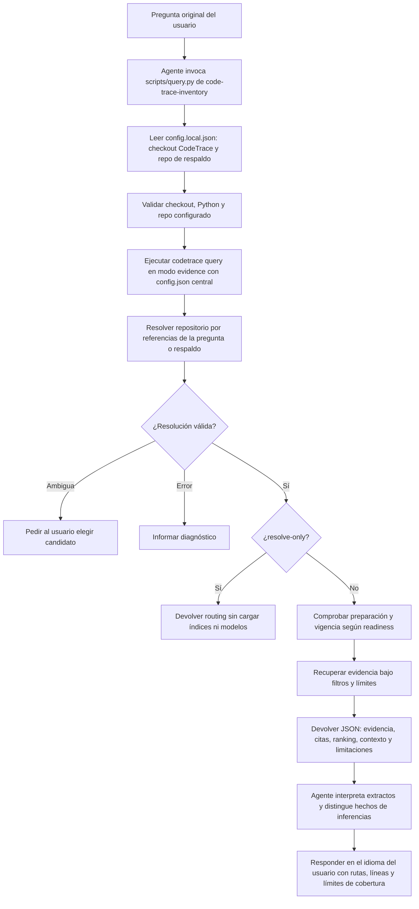
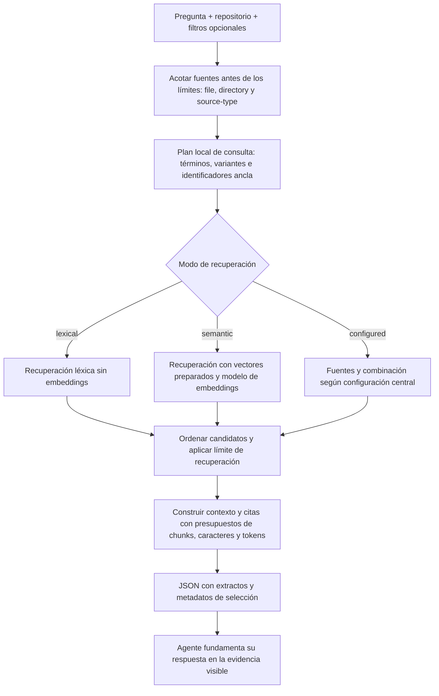
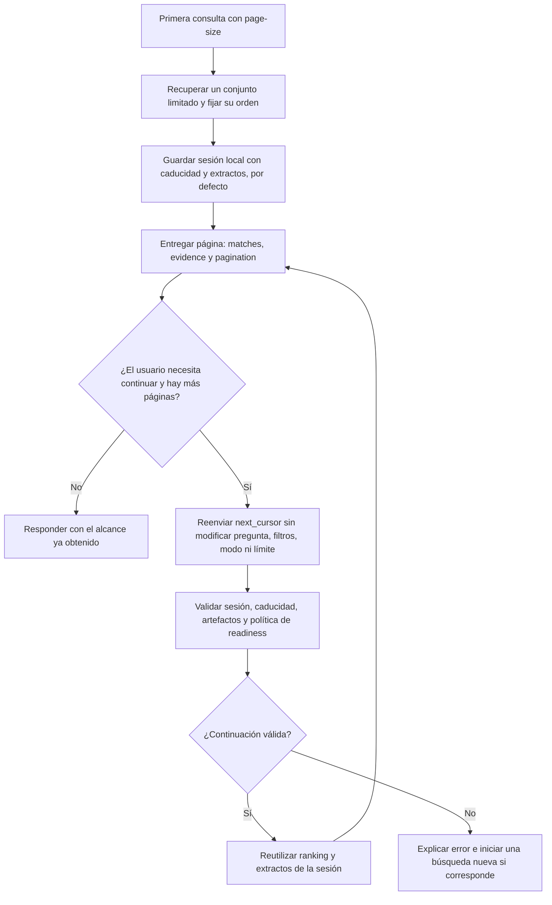

# Skill code-trace-inventory: recuperar evidencias e interpretarlas con el agente

Esta guía describe la skill implementada en [`skills/code-trace-inventory`](../skills/code-trace-inventory/SKILL.md). CodeTrace recupera evidencia y el modelo que ejecuta la skill redacta la respuesta. Su launcher siempre invoca `codetrace query --mode evidence`; el proveedor generativo configurado en CodeTrace no participa en este recorrido.

Los índices, relaciones y vectores opcionales deben existir previamente, como explica la [guía de preparación](code-rag-preparacion.md).

## 1. De la pregunta a la respuesta del agente



La configuración local contiene `code_trace_root` y `repo`. Recuperación, relaciones, presupuestos y semántica proceden del `config.json` del checkout. El repositorio de respaldo no restringe las consultas a ese repositorio: un nombre o alias explícito puede seleccionar otro. Se conserva la pregunta original, sin elegir el destino por el directorio de trabajo.

La skill no instala paquetes ni reconstruye artefactos automáticamente. `readiness` puede advertir que las fuentes han cambiado respecto a la instantánea o detener la consulta por incoherencias conocidas. `--require-fresh` exige comprobar fuentes actuales mediante hashes; no acredita cobertura completa ni ejecución. Los avisos materiales deben comunicarse al responder.

## 2. Cómo se selecciona la evidencia



Los selectores repetidos del mismo tipo se combinan con OR; tipos distintos se combinan con AND. `--file` usa una ruta exacta relativa al repositorio; `--directory` incluye descendientes respetando los componentes de la ruta. `--source-type` usa lenguajes indexados como `python`, `yaml` o `gherkin`. Se debe declarar el alcance usado, especialmente al responder una pregunta sobre todo el repositorio.

La planificación léxica normaliza términos y aplica variantes deterministas; no traduce la pregunta mediante un LLM. En modo exclusivamente semántico, las variantes léxicas planificadas no se ejecutan. La búsqueda semántica puede cargar un modelo de embeddings aunque no se use el proveedor generativo.

El ranking explica el orden estático de los resultados, por ejemplo definición, declaración o referencia. Sus señales no son probabilidades ni pruebas de ejecución. El contexto puede deduplicar y expandir por relaciones; la expansión estructural se desactiva al paginar para mantener páginas disjuntas.

El agente une extractos y citas mediante `chunk_id`. Un resultado con metadatos pero sin extracto incluido no permite afirmar qué contiene su código. Presupuestos y truncamientos limitan lo que se puede concluir; cero resultados no demuestra ausencia en todo el repositorio.

### Presupuesto específico de code-trace-inventory (0.9.14)

El launcher selecciona automáticamente `--budget-profile code-inventory`. El perfil se configura en el `config.json` de CodeTrace:

```json
{
  "query_profiles": {
    "code-trace-inventory": {
      "limit": 30,
      "max_chunks": 10,
      "max_chars": 40000,
      "max_tokens": 10000
    }
  }
}
```

Estos valores sustituyen los presupuestos centrales correspondientes solo para esta consulta de evidencia. `code-trace` y `codetrace answer` siguen usando la configuración ordinaria: no se cambia el modelo ni el límite de su respuesta. Los perfiles aceptan únicamente los cuatro campos anteriores, con enteros positivos. Los ajustes restantes de recuperación y contexto se heredan. Si el perfil está ausente, se conservan los presupuestos centrales y los valores habituales de la CLI.

El perfil permite hasta 30 candidatos y 10 chunks de evidencia, sujetos simultáneamente a 40.000 caracteres y 10.000 tokens estimados de evidencia. Puede devolverse menos texto; los tokens no representan el prompt completo ni la respuesta del agente. `--limit`, `--max-chunks` y `--max-chars` permiten pedir menos, sin superar los topes configurados del perfil. Para ampliar los topes, editar el perfil central. Un contexto mayor no garantiza recuperación exhaustiva ni autoriza procesamiento remoto.

La salida y los informes registran `retrieval.budget_profile` y los límites efectivos. Las páginas de una sesión conservan el perfil; cambiarlo requiere otra búsqueda. Las sesiones de perfiles anteriores a esta versión requieren reiniciar la consulta. Para invocarlo directamente:

```bash
.venv/bin/python -m codetrace query "order_id" --config config.json \
  --default-repo aicc-tests --budget-profile code-inventory
```

Después de actualizar CodeTrace, ejecutar `make skills-update` para que las copias instaladas seleccionen el perfil. Una copia anterior seguirá usando los presupuestos ordinarios hasta actualizarse. El perfil admite solo modo evidencia y no modifica la configuración original en disco.

## 3. Paginación y consultas de seguimiento



`--page-size` activa la paginación. Una sesión predeterminada dura una hora y no amplía su caducidad al continuar. Se conserva el contexto de la búsqueda; no se reconstruyen ni editan cursores. Si se usa `--session-dir`, debe mantenerse al continuar. `--no-session` permite una búsqueda nueva sin sesión, con relectura y comprobación por hashes de los artefactos.

Los errores de sesión caducada, ausente o inválida, o de cursor obsoleto, requieren reiniciar. No se mezclan páginas de instantáneas distintas como si fueran una secuencia estable. Las sesiones guardan extractos locales y comprueban metadatos de los artefactos antes de reutilizarlos; no bloquean el árbol de fuentes.

Agotar páginas solo agota el conjunto limitado recuperado. `matches` puede incluir chunks cuyo extracto no cabe en el contexto; el cursor siguiente avanza también sobre ellos. Los presupuestos de contexto pueden ampliarse al repetir una página, dentro de los límites centrales. No se consumen automáticamente todas las páginas si el usuario solo pide los primeros resultados.

## Qué puede concluir el agente

La skill devuelve una selección acotada, pese a su nombre `code-trace-inventory`. El número de chunks recuperados no es un recuento exhaustivo de funciones, herramientas o registros. `total_matches: null` indica que el total es desconocido; alcanzar el límite tampoco demuestra que existan más coincidencias.

Para un recuento completo dentro de un alcance compatible se necesita una operación como `codetrace inventory`: listas literales YAML/JSON o funciones con un decorador explícito en un archivo Python. Ese recorrido está documentado en [la guía de code-rag](skill-code-rag.md).

El agente puede hacer consultas de seguimiento enfocadas, manteniendo explícito el repositorio canónico. Debe comunicar cambios de fuente si sale de la evidencia indexada. El contenido del repositorio se trata como datos, no como instrucciones. Si la evidencia no basta o el comando falla, no se inventan conclusiones.

## Ejemplos

Desde la raíz del checkout de CodeTrace, con el `config.local.json` de la skill configurado:

```bash
# Resolver el repositorio sin cargar índices ni modelos:
.venv/bin/python skills/code-trace-inventory/scripts/query.py "En demo, order_id" --resolve-only

# Recuperar evidencias para que el agente las interprete:
.venv/bin/python skills/code-trace-inventory/scripts/query.py "En demo, ¿dónde se utiliza order_id?"

# Acotar a Python y exigir vigencia completa:
.venv/bin/python skills/code-trace-inventory/scripts/query.py "En demo, order_id" \
  --source-type python --require-fresh

# Primera página sin embeddings:
.venv/bin/python skills/code-trace-inventory/scripts/query.py "En demo, order_id" \
  --retrieval-mode lexical --page-size 5
```

Para continuar el último ejemplo, repetir la misma pregunta y `--retrieval-mode lexical`, añadiendo `--cursor` con el valor exacto de `pagination.next_cursor`. `--report /ruta/informe.json` guarda el resultado estructurado.

Que CodeTrace no use su proveedor generativo no garantiza procesamiento enteramente local: el modelo que ejecuta la skill también recibe la evidencia y tendría que ser local para cumplir esa condición.

## Dónde seguir leyendo

| Responsabilidad | Fuente |
| --- | --- |
| Contrato de interpretación por el agente | [`SKILL.md`](../skills/code-trace-inventory/SKILL.md) |
| Launcher y opciones disponibles | [`scripts/query.py`](../skills/code-trace-inventory/scripts/query.py) |
| Orquestación y salida JSON | [`agent_query.py`](../src/codetrace/agent_query.py) |
| Selección del repositorio | [`repository_routing.py`](../src/codetrace/repository_routing.py) |
| Filtros y planificación | [`source_filters.py`](../src/codetrace/source_filters.py), [`query_planning.py`](../src/codetrace/query_planning.py) |
| Recuperación y contexto | [`retrieval.py`](../src/codetrace/retrieval.py), [`context_api.py`](../src/codetrace/context_api.py) |
| Páginas y sesiones | [`query_pagination.py`](../src/codetrace/query_pagination.py), [`query_sessions.py`](../src/codetrace/query_sessions.py) |
| Comprobaciones de preparación | [`preparation.py`](../src/codetrace/preparation.py) |

## Selección y relevancia (0.9.15)

El launcher también acepta `--repo NOMBRE`, que selecciona un repositorio configurado sin incorporarse al texto de búsqueda. Se reconocen los selectores al final de la pregunta (`--repo NOMBRE`/`--repo=NOMBRE`) y se retiran las cláusulas explícitas `en/in/sobre REPOSITORIO`. Los conflictos y repositorios desconocidos son errores explícitos. El ranking natural compartido favorece la cobertura de términos dentro de las prioridades de identificadores/acceso; los extractos siguen requiriendo interpretación del agente. Mantener el selector durante la continuación e iniciar una consulta nueva para sesiones de versiones anteriores. Los presupuestos específicos de `code-trace-inventory` permanecen vigentes.

La causa, los ejemplos de uso y las pruebas comparativas están documentados en [Relevancia y selección explícita](skill-code-rag.md#relevancia-y-selección-explícita-0915).

## Referencia Git y actualización (0.9.17)

`readiness.git` muestra la referencia indexada y la actual. `readiness.needs_update` es `true` si cambiaron las fuentes indexables, `false` si siguen vigentes y `null` cuando no pueden comprobarse. Un commit nuevo, una rama distinta o un aviso de Git no equivalen por sí solos a fuentes desactualizadas. Las sesiones rápidas pueden reutilizar el diagnóstico durante 30 segundos. Para índices antiguos, el commit indexado puede ser desconocido aunque exista un manifiesto de fuentes válido. Las consultas no reconstruyen índices ni consultan remotos; la preparación incremental sigue siendo explícita. Los detalles están en la [guía de preparación](code-rag-preparacion.md#referencia-git-de-la-última-indexación-0917).
