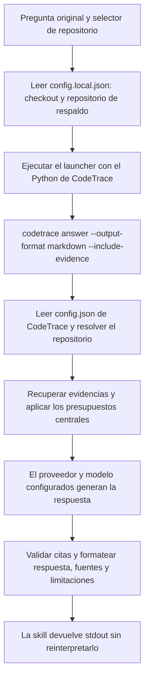

# Skill code-trace

La skill utiliza siempre `codetrace answer`. El modelo que ejecuta la skill actúa como lanzador y devuelve literalmente la respuesta del proveedor configurado en CodeTrace, con sus evidencias y limitaciones. No elige un modo de recuperación, inventario o interpretación propio.

## Flujo de una petición (0.9.16)



Esto se aplica también a «cuántas tools intervienen en el handoff». La palabra «cuántas» no selecciona un inventario de listas. Desde 0.9.16, el launcher rechaza `--mode inventory`, `--mode evidence` y las opciones de esos modos. `--mode answer` se acepta por compatibilidad; no es necesario indicarlo. Los errores del proveedor no activan otro backend ni otra skill.

## Configuración e invocación

El `config.local.json` instalado contiene `code_trace_root` y `repo`. Las rutas relativas del checkout se resuelven desde ese archivo. El repositorio por defecto debe existir en el catálogo central; `--repo` o una referencia explícita en la pregunta permiten seleccionar otro. No se deduce el destino desde el directorio de trabajo.

```json
{
  "code_trace_root": "/absolute/path/to/code-trace",
  "repo": "aicc-tests"
}
```

Usar siempre el entorno de CodeTrace:

```bash
"/absolute/path/to/code-trace/.venv/bin/python" \
  "/absolute/path/to/code-trace/scripts/query.py" \
  "cuantas tools intervienen en el handoff" --repo fabrica
```

En Windows, utilizar `.venv/Scripts/python.exe`. `--config PATH` selecciona otro archivo de conexión de la skill. El pipeline procede siempre del `config.json` del checkout indicado: repositorios, recuperación, relaciones, embeddings, presupuestos y proveedor/modelo de generación. El launcher ya no introduce topes predeterminados propios de candidatos, chunks o caracteres; solo reenvía `--limit`, `--max-chunks` y `--max-chars` si se proporcionan explícitamente. Los valores omitidos los resuelve `codetrace answer` con su configuración y valores internos.

No se instala ni prepara nada automáticamente al consultar. Una configuración sin proveedor generativo habilitado produce un error, en lugar de cambiar a inventario. El procesamiento remoto sigue requiriendo autorización explícita cuando corresponda.

## Respuesta, conteos y evidencias

La skill conserva el stdout completo: respuesta del proveedor, fuentes, extractos y limitaciones. No traduce ni completa la respuesta con búsquedas propias. La validación comprueba citas y rangos contra el contexto; no demuestra toda la corrección semántica del razonamiento.

La recuperación es acotada. Un conteo sobre comportamiento o relaciones puede necesitar más evidencia o una definición precisa del alcance; el proveedor debe reconocerlo. El número de chunks no acredita el total de herramientas ni su ejecución. La skill no convierte esa incertidumbre en una petición arbitraria de archivo/lista YAML o JSON.

Los conteos estructurales exactos siguen disponibles como operación CLI independiente en [Inventarios de CodeTrace](code-rag-inventory.md). La skill `code-trace-inventory` mantiene su flujo separado de evidencia interpretada por el agente. Ninguna de esas opciones es un modo alternativo de `/code-rag`.

## Diagnóstico y actualización

`--report PATH` guarda la respuesta y su contexto. `--resolve-only`, solicitado explícitamente para diagnóstico, se implementa en `codetrace answer` y devuelve el repositorio y la pregunta normalizada sin leer índices ni cargar modelos; no genera una respuesta y no puede guardar un informe de respuesta.

Después de actualizar el checkout:

```bash
make skills-update
```

No se necesitan índices nuevos por este cambio. Las instrucciones ejecutables de la skill están en [`SKILL.md`](../skills/code-trace/SKILL.md), y su launcher en [`scripts/query.py`](../skills/code-trace/scripts/query.py).

## Relevancia y selección explícita (0.9.15)

La petición que motivó esta corrección era `/code-rag en que tools se incluye en handoff en fábrica --repo fabrica`. Antes, el sufijo `--repo fabrica` entraba en la búsqueda como texto y favorecía claves como `repo_url` y `repo_name`. Además, «en fábrica» permanecía en la pregunta y competía con el concepto buscado.

Ahora ambas skills, `codetrace answer` y `codetrace query` aceptan `--repo fabrica`. La selección explícita puede acompañar al repositorio de respaldo (`--default-repo`); una contradicción con otro selector o una referencia explícita a otro repositorio produce `conflicting_repository`. Un repositorio desconocido produce `unknown_repository`. Se mantiene la validación de la configuración local de la skill.

También se reconoce un selector sin comillas al final del texto de la pregunta: `--repo NOMBRE` o `--repo=NOMBRE`. Los nombres de este argumento deben ser claves del catálogo central. Para preguntar por el argumento como código, citarlo con comillas o backticks. Las cláusulas de alcance `en/in/sobre REPOSITORIO` se retiran antes de la recuperación y la generación, tanto al principio como en medio o al final. Se conservan los identificadores usados como tema de la pregunta y los fragmentos entrecomillados. Los alias de dominio en medio o al final, como `Pix`, se mantienen como términos salvo que se indiquen explícitamente como repositorio; los nombres canónicos y sus variantes equivalentes sí se retiran como alcance. La pregunta original sigue disponible en los informes y la versión normalizada en `routing.query`.

```bash
.venv/bin/python skills/code-trace/scripts/query.py \
  "¿Qué tools incluyen handoff?" --repo fabrica

.venv/bin/python -m codetrace query "¿Qué tools incluyen handoff?" \
  --config config.json --repo fabrica --retrieval-mode lexical
```

El ranking `identifier-v2` mantiene la prioridad de identificadores y perfiles de acceso; dentro de esa prioridad, ordena las consultas naturales por cobertura de términos antes de la puntuación. La señal `ranking.term_coverage` se calcula también para candidatos híbridos, evitando que una puntuación semántica alta desplace una coincidencia literal más amplia. El modo exclusivamente semántico conserva su ordenación anterior. Esta cobertura solo describe coincidencias escritas: no demuestra relevancia semántica, ejecución o exhaustividad. Los cambios de perfiles invalidan sesiones anteriores; iniciar una consulta nueva tras actualizar.

El prompt pide respuestas y limitaciones en el idioma de la pregunta, con indicaciones explícitas para preguntas claramente españolas/inglesas y peticiones explícitas de esos idiomas. Los idiomas ambiguos quedan a interpretación del proveedor. También comunica cuántos candidatos llegaron al contexto y cuántos se excluyeron, exige reconocer el alcance parcial y pide no citar fragmentos ajenos a la afirmación. La skill sigue devolviendo literalmente la salida del proveedor. La validación programática comprueba citas y rangos; no prueba que cada afirmación esté semánticamente respaldada ni garantiza el idioma de salida.

`evaluations/relevance_questions.json` incorpora la pregunta original y variantes de selección. `evaluations/relevance-validation.0.9.15.json` compara la selección/ranking anterior y actual sobre los mismos artefactos y etiquetas: 9/10 en la batería original, 3/3 en la acotada y mejora de 1/5 a 5/5 en la nueva, sin regresiones. El caso pendiente de escritores/lectores de AICC continúa fallando; no se modificaron sus etiquetas. Son comprobaciones de recuperación, no una evaluación completa de respuestas generadas. Una prueba adicional con Ollama y `qwen2.5-coder:14b`, sobre ese contexto real, devolvió la lista en español, con tres citas válidas y una limitación explícita de exhaustividad. Es una observación puntual, no una garantía para todas las preguntas.

Ejecutar `make skills-update` para actualizar las copias instaladas. No es necesario reconstruir índices para esta corrección.

## Commit indexado y fuentes actuales (0.9.17)

`codetrace answer` incorpora `index_state` en JSON/informes y un bloque «Estado del índice» en la salida con evidencias. Permite ver el commit indexado y el actual, la rama, cambios locales y si las fuentes requieren actualización. La skill lo transmite literalmente junto con la respuesta del proveedor. Un SHA distinto puede corresponder solo a documentación y no obliga a reconstruir. La actualización sigue siendo explícita con `make indexes-incremental REPOS="NOMBRE"`; los índices antiguos requieren una preparación para registrar su referencia Git. Véase la [guía de preparación](code-rag-preparacion.md#referencia-git-de-la-última-indexación-0917).
